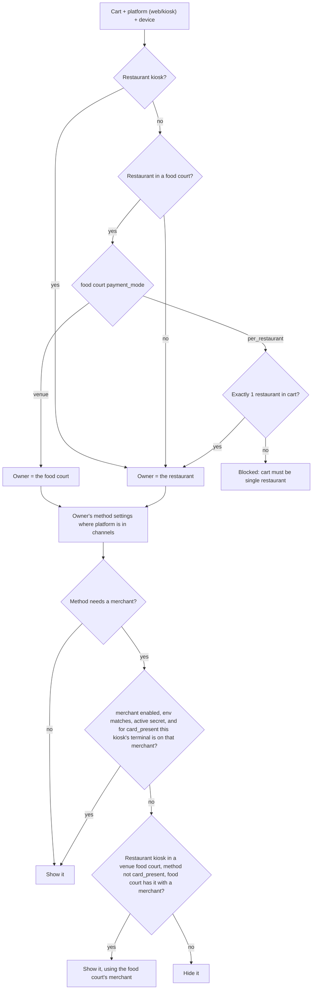
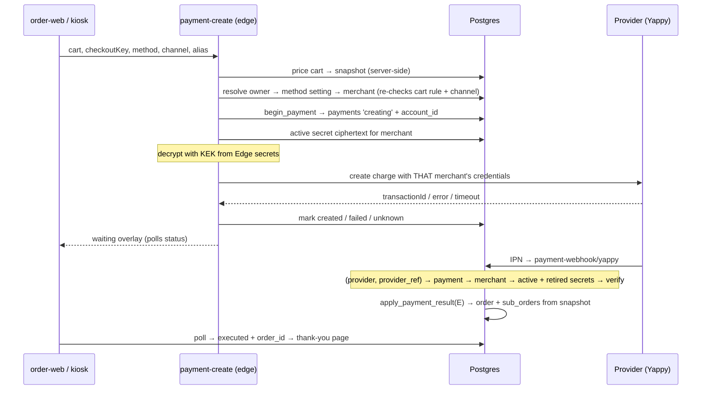
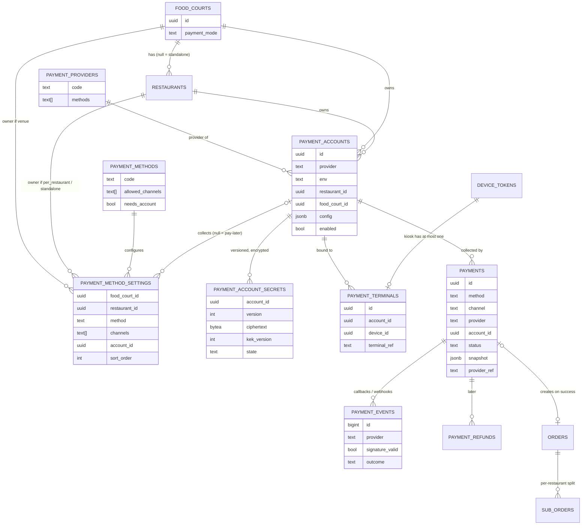

# Plan: Payments architecture — payment methods per platform, venue vs per-restaurant

Status: **draft, iterating** · Started 2026-10-25 · Owner: Edgar · Rev 4 (mode drives cart, methods per platform)
Related: `plans/payments-phase-2.md` (implementation handover), `plans/payments-onboarding.md` (admin-web onboarding), `plans/payments-test-matrix.md` (every combination), `plans/yappy-test-plan.md` (Yappy UAT), migrations `049_yappy_payments.sql`, `050_yappy_shorter_grace.sql`

## 1. Context and goals

The Yappy pay-first flow (migration 049) works end to end in UAT, but it is hard-wired to **one merchant per
environment**, read from Edge Function secrets (`YAPPY_UAT_MERCHANT_ID` / `YAPPY_UAT_SECRET`). Before production
we generalize, while the only data is test data.

The platform must support:

- **Venue food courts** — one order can hold several restaurants; one payment goes to **one merchant for the whole
  food court** (Kiki's or the food court's own); the collector pays restaurants out.
- **Per-restaurant food courts** — one restaurant per order; the payment goes straight to **that restaurant's**
  merchant.
- **Standalone restaurants** (`restaurants.food_court_id` null) — same as per-restaurant: its own methods, its
  own merchants.
- **Methods per platform** — every food court / restaurant chooses which payment methods it offers on **web**
  and on **kiosk**, independently.
- **Many providers / gateways** — Yappy, Banco General / Banistmo terminals, card gateways (with Apple / Google
  Pay), each owner using whichever it has a contract with.

### 1.1 How it fits together

| term | what it is | example |
|---|---|---|
| **Method** | what the customer taps at checkout | "Yappy", "Tarjeta", "Efectivo en caja" |
| **Platform** (`channel`) | where the order is placed | `web` (order-web), `kiosk` |
| **Payment owner** | who decides the methods and gets paid for a cart | Plaza Mayor (venue) / Sushi Bar (per-restaurant or standalone) |
| **Provider** | the company that moves the money; we write one adapter per provider | Yappy, BG terminal, a card gateway |
| **Merchant** (`payment_accounts`) | one business's account at one provider: merchant id + secret key. Whoever owns it receives the money. **Not a bank account** — which bank the provider pays into is between the merchant and the provider, outside kiki. | "Plaza Mayor — Yappy", "Kiki — Yappy", "Sushi Bar — Banistmo" |
| **Method setting** (`payment_method_settings`) | one row per owner × method: on which platforms it is shown and **which merchant** collects it (this is the "route") | Plaza Mayor + Yappy → web ✓ kiosk ✓ → merchant "Plaza Mayor — Yappy" |

```
cart ─▶ payment owner ─▶ method settings (enabled for this platform) ─▶ merchant ─▶ provider adapter ─▶ money lands with merchant owner
```

### 1.2 Principles
1. **The money record survives.** A charge is recorded before the provider is called; a success is never lost
   even if order creation fails (as in 049).
2. **Server decides everything about money:** price (snapshot), merchant (frozen at begin), outcome (verified
   callback only). The client only displays. The server re-checks the cart rule and method availability.
3. **Who can redirect money is the main threat.** Changing which merchant a method uses is restricted,
   constrained in the DB, audited and alerted.
4. **No card data on our servers (PCI SAQ-A).** Cards only via terminals or provider-hosted pages/fields (incl.
   Apple / Google Pay through the gateway). Never a PAN in our DB, logs or functions.
5. **Secrets need two keys to read:** DB access alone or function access alone is not enough.

## 2. Payment mode decides the cart and the owner

One setting per food court: `food_courts.payment_mode` = `venue` | `per_restaurant`. It decides everything:

| | `venue` food court | `per_restaurant` food court | standalone restaurant |
|---|---|---|---|
| Cart | **several restaurants allowed** | **one restaurant only** ("Tu pedido es de X, ¿vaciar carrito?") | one restaurant (itself) |
| Payment owner | the food court | the restaurant in the cart | the restaurant |
| Who configures methods | food court admin (restaurants inside don't) | each restaurant | the restaurant |
| Who collects online payments | Kiki's or the food court's own merchant (per method) | the restaurant's own merchant | the restaurant's own merchant |
| Payout to restaurants | the collector, from the `sub_orders` split; Kiki provides the settlement report | none — already theirs | none |
| Refunds | from the collector's merchant, then settle with restaurant | from the restaurant's merchant | same |

No mixed setups: a food court is one or the other, so checkout always shows the same methods regardless of what
is in the cart. The cart rule is enforced in order-web, the kiosk and again on the server (create rejects a
multi-restaurant cart at a `per_restaurant` food court).

**Changing a food court's mode** is a Kiki ops action: admin warns which restaurants have no methods configured
yet; carts already open are revalidated at checkout (`cart_invalid` → "Tu carrito tiene varios restaurantes").

Plaza Mayor today = `venue`, Yappy on web via the current UAT merchant, pay-later methods as now → same behavior.

### 2.1 Restaurant kiosks: the kiosk decides, not the food court

A kiosk is deployed either for a **food court** (`device_tokens.food_court_id`: shows all its restaurants) or for
**one restaurant** (`device_tokens.restaurant_id`). A restaurant kiosk always behaves like a standalone
restaurant, even when that restaurant belongs to a food court:

| where the order is placed | menu / cart | payment owner | methods from |
|---|---|---|---|
| web (food court QR / link) | food court rules (table above) | food court rules | food court rules |
| food court kiosk | food court rules | food court rules | food court rules |
| **restaurant kiosk** | that restaurant only | **the restaurant** | the restaurant's settings for `kiosk` |

Example: Restaurant A is in `venue` food court A.
- Web: the customer sees all of food court A, mixes restaurants, pays once by Yappy → food court A's (or Kiki's)
  merchant.
- Restaurant A's kiosk: only A's menu; Datáfono → A's own BG terminal merchant; Yappy → A's own Yappy merchant,
  or **fallback** to food court A's Yappy merchant (same as web) if A has none; pay-later as A enables.

**Fallback rule (restaurant kiosks in a `venue` food court only):** A turns a pay-first method on for its kiosk;
if A has its own merchant for it, that one is used; otherwise the food court's merchant for that method is used,
provided the food court has that method enabled with a merchant. Never for `card_present` (terminal is A's).
In `per_restaurant` food courts and for standalone restaurants there is no venue merchant, so no fallback.

**Payout follows the merchant, not the device:** a payment collected by A's merchant is directly collected and
left out of the venue payout; one collected by the food court's / Kiki's merchant (web, food court kiosk, or the
fallback) goes into the payout split as usual. Derived from `payments.account_id`'s owner.

## 3. Methods and platforms

### 3.1 Catalog (fixed in code + seeded table `payment_methods`)

| code | checkout label | web | kiosk | needs merchant | when paid |
|---|---|---|---|---|---|
| `card_online` | Tarjeta | ✓ | — | yes (card gateway) | before the order (pay-first) |
| `wallet` | Apple Pay / Google Pay | ✓ | — | yes (card gateway) | pay-first |
| `yappy` | Yappy | ✓ | ✓ | yes (Yappy) | pay-first (customer approves in the Yappy app) |
| `card_present` | Tarjeta (datáfono) | — | ✓ | yes (BG / Banistmo) + the kiosk's terminal — **single-restaurant kiosks only** | at the kiosk, before the order |
| `cash_counter` | Efectivo en caja | ✓ | ✓ | no | later — staff marks paid |
| `yappy_on_delivery` | Yappy en entrega | ✓ | ✓ | no | later — staff marks paid |
| `card_on_delivery` | Tarjeta en entrega | ✓ | ✓ | no | later — staff marks paid |

The web / kiosk columns are what is **possible**; the owner turns each one on or off.

**Datáfono = one merchant = one restaurant's kiosk.** A terminal is linked to exactly one bank merchant, so
`card_present` exists only on restaurant kiosks (2.1), on that restaurant's merchant. Food court kiosks never
offer it, in `venue` and `per_restaurant` alike — they show Yappy / pay-later instead.

- **Pay-first** methods (need a merchant): the order is created only after the provider confirms (the 049 flow).
- **Pay-later** methods (no merchant): the order is created immediately, `payment_status = pending` (POR COBRAR),
  as `create-web-order` does today. No provider, no money through kiki. In a multi-restaurant `venue` order each
  restaurant collects its own part at handover (`sub_orders.payment_status`, same as COS today).

### 3.2 Each owner enables methods per platform

`payment_method_settings` — one row per owner × method:

| column | notes |
|---|---|
| `food_court_id` / `restaurant_id` | exactly one set = the payment owner |
| `method` | FK `payment_methods.code` |
| `channels text[]` | where it is shown: `{web}`, `{kiosk}`, `{web,kiosk}`; ⊆ what the method allows |
| `account_id` null | the merchant that collects; required iff the method needs a merchant, null for pay-later |
| `sort_order` | order at checkout |

Example — Plaza Mayor (`venue`):

| method | web | kiosk | merchant |
|---|---|---|---|
| `yappy` | ✓ | ✓ | Plaza Mayor — Yappy (or Kiki — Yappy) |
| `card_online` | ✓ | — | Kiki — card gateway |
| `wallet` | ✓ | — | Kiki — card gateway |
| `cash_counter` | ✓ | ✓ | — |
| `card_on_delivery` | — | ✓ | — |

Example — standalone "Sushi Bar": `yappy` web only (its own Yappy merchant), `card_present` kiosk (its own
Banistmo terminal), `cash_counter` web + kiosk.

In a `per_restaurant` food court the food court does **not** restrict its restaurants: each restaurant decides
its own methods. A restaurant never sees a method it has not configured; a missing row = not offered. One merchant can back
several methods (`card_online` and `wallet` on the same gateway merchant) and, for Kiki's merchants, many owners.

### 3.3 What checkout shows



`resolve_payment_options(cart, channel, device_id)` returns the method codes + labels only (no merchant details);
order-web and the kiosk render exactly that list. If nothing pay-first is available, pay-later methods still
work, so checkout never dead-ends.

### 3.4 Online pay-first (Yappy today, card / wallet later)



`card_present` at the kiosk: the kiosk charges on its own terminal (the server checks it is on the cart
restaurant's merchant),
then writes a `payments` row with the approval → same ledger, order created from the snapshot.

### 3.5 Entities



## 4. Security model

### 4.1 Threats and controls
| threat | control |
|---|---|
| Someone points a method at their own merchant (money redirection) | authz matrix (4.2); DB constraints (4.3); audit log + Kiki alert on every `account_id` change; merchant frozen per payment at begin |
| DB dump / SQL access / leaked service key reads merchant secrets | envelope encryption (4.4): ciphertext in DB, KEK only in Edge Function secrets |
| Forged success callback | signature verified with the paying merchant's secret; order created only on verified `E`; unknown `provider_ref` → logged, no effect |
| Replayed callback | idempotent `apply_payment_result`; `executed` terminal |
| Tampered amount / cart / method | price + snapshot server-side; server re-resolves owner, cart rule and method for the channel; callback amounts ignored |
| Card data exposure | PCI principle: terminals / hosted pages only |
| Prod credentials used in UAT (or vice versa) | merchant `env` must equal the function's env; base URLs per env in Edge secrets |
| Abuse / card-testing style floods | rate limits per payer / table / IP; circuit breaker per merchant (as in 049) |

### 4.2 Who can do what
| action | Kiki ops | food court admin | restaurant owner | restaurant staff | anon |
|---|---|---|---|---|---|
| Set a food court's `payment_mode` | yes | request only | — | — | — |
| Create/disable Kiki merchant | yes | — | — | — | — |
| Create/disable food court merchant | yes | own food court | — | — | — |
| Create/disable restaurant merchant | yes | — | own restaurant | — | — |
| Set/rotate a secret | yes | own food court's merchants | own restaurant's merchants | — | — |
| Read a secret | **nobody** (write-only; only edge functions decrypt) | | | | |
| Turn methods on/off per platform, sort | yes | own food court (venue) | own restaurant (per-restaurant / standalone) | — | — |
| Change which merchant a method uses | yes | own food court's merchants; switching to/from Kiki's merchant needs Kiki ops | own restaurant's merchants only | — | — |
| See payments | all | own food court | own restaurant | own restaurant | own (by payment id) |

All writes go through an edge function (`payment-admin`) that checks the caller's role, encrypts secrets and writes
the audit row. Tables: RLS on, no direct `INSERT/UPDATE` for `anon`/`authenticated`.

### 4.3 DB constraints (hold even with a bug in the app)
- `payment_accounts` and `payment_method_settings`: at most / exactly one of `restaurant_id`, `food_court_id`.
- Settings owned by a restaurant → `account_id` belongs to **that restaurant**.
- Settings owned by a food court → `account_id` is Kiki's or belongs to **that food court**.
- Restaurant-owned settings: any channel for restaurants in a `per_restaurant` food court or standalone; in a
  `venue` food court only `channels = {kiosk}` (their own kiosks, 2.1), `account_id` = own merchant or null
  (null = fallback to the food court's merchant, resolved at begin and frozen in `payments.account_id`). Food-court-owned settings only for `venue`
  food courts (checked on mode change too).
- `account_id` required iff `payment_methods.needs_account` (except the restaurant-kiosk fallback above); the merchant's provider supports the method
  (`payment_providers.methods`); `channels` ⊆ `payment_methods.allowed_channels`.
- `card_present` settings only for restaurant owners; `payment_terminals.device_id` must be a single-restaurant
  kiosk (`device_tokens.restaurant_id` not null) and `account_id` must belong to that same restaurant.
- Cross-table checks by trigger, tested in the SQL test matrix.

### 4.4 Secrets
- `payment_account_secrets(account_id, version, ciphertext, nonce, kek_version, state: active|retired|revoked, created_at, retired_at)`.
- Encryption: AES-256-GCM in the edge function; KEK = Edge Function secret `PAYMENTS_KEK_<n>`; `kek_version`
  allows KEK rotation by re-encrypting rows.
- Merchant key rotation: new version → `active`, old → `retired`. Callback verification tries `active` then
  `retired` (retired kept e.g. 7 days, then `revoked`), so late IPNs still verify.
- Secrets never returned by any API, never logged; logs redact `Authorization` and tokens.

## 5. Data model

### `food_courts` (new column)
`payment_mode text NOT NULL DEFAULT 'venue' CHECK (payment_mode IN ('venue','per_restaurant'))`.

### `payment_methods` (reference, seeded)
`code` PK, `label`, `allowed_channels text[]`, `needs_account bool`, `kind` (`pay_first` | `pay_later`). Section 3.1.

### `payment_providers` (reference, seeded)
`code` PK (`yappy`, `bg_ecr`, `banistmo_ecr`, card gateway…), `methods text[]`. Mirrors the adapter registry so DB
constraints can check method support; a test asserts the two agree.

### `payment_method_settings`
Section 3.2. Unique `(food_court_id, method) WHERE food_court_id IS NOT NULL`,
`(restaurant_id, method) WHERE restaurant_id IS NOT NULL`. Constraints 4.3.

### `payment_accounts` — one merchant at one provider (credentials, not a bank account)
| column | notes |
|---|---|
| `id` uuid PK | |
| `provider` text FK | `payment_providers.code` |
| `env` text | `uat` / `prod` |
| `display_name` text | "Kiki — Yappy", "Sushi Bar — Banistmo" |
| `restaurant_id` uuid null FK | owner = restaurant |
| `food_court_id` uuid null FK | owner = food court; both null = Kiki |
| `config` jsonb | non-secret, validated per provider in code (Yappy: `merchantId`, `domain`) |
| `enabled` bool, `disabled_reason`, `disabled_at` | circuit breaker per merchant |

### `payments` — replaces `yappy_payments` (pay-first only)
Same lifecycle as 049 (`creating → created | failed | unknown → executed | cancelled | expired`) and guarantees.
| column | notes |
|---|---|
| `method`, `channel`, `provider`, `account_id` (FK, NOT NULL) | frozen at begin |
| `food_court_id` null, `restaurant_id` null | the owner at begin |
| `device_id` null | kiosk that took it (ops / audit; payout is derived from the merchant owner) |
| `provider_ref` | Yappy `orderId`; **`UNIQUE (provider, provider_ref)`** |
| `provider_txn_id` | Yappy `transactionId`, terminal auth code |
| `payer_ref` | Yappy alias; null for terminals. Active-attempt unique `(provider, payer_ref)` |
| `provider_data` jsonb | provider-specific (Yappy `document_name`, token) |
| rest as 049 | amounts, `snapshot`, `checkout_key`, `order_id`, `refund_required`, `fulfillment_error`, `resolved_at`, `resolution_note` |
Indexes: partial `(account_id, created_at) WHERE status IN ('creating','created','unknown')` for stale expiry and
breaker; `(food_court_id, created_at desc)`, `(restaurant_id, created_at desc)` for ops.

### `orders` / `sub_orders.payment_method`
Becomes FK-like to `payment_methods.code`. Today's values are ambiguous: `'yappy'` means *Yappy en entrega* in
`create-web-order` but *paid by Yappy* in 049 (told apart only by `payment_status`). Migration: unpaid `'yappy'` →
`yappy_on_delivery`; `cash_on_delivery` → `cash_counter` (efectivo en entrega is dropped); `card_on_delivery` unchanged; 049 rows stay `yappy`.
Update `PaymentMethod` types + labels in order-web, admin, admin-web, printer service, create-web-order.

### `payment_events` — replaces `yappy_ipn_events`
`provider`, `provider_ref`, `raw` (query/body, no secrets), `signature_valid`, `outcome`, `received_at`.
Retention: keep N months online, then archive (N to decide; reconciliation needs at least the dispute window).

### `payment_terminals`
`account_id`, `device_id` (FK `device_tokens`, the kiosk), `terminal_ref`. **Unique `device_id`**: one terminal per
kiosk, one merchant per terminal. Kiosk must be a single-restaurant kiosk of the merchant's restaurant.

### `payment_refunds` (later, shape reserved)
`payment_id`, `amount_cents`, `reason`, `initiated_by`, `provider_ref`, `status`. Supports partial refunds.

### `payment_config_audit`
Trigger-written on every insert/update/delete of `payment_accounts`, `payment_method_settings`,
`payment_account_secrets` (metadata only, never ciphertext) and `food_courts.payment_mode`: who, when, before,
after.

### Functions
- `resolve_payment_options(food_court_id, restaurant_ids[], channel, device_id null)` → methods to show (3.3).
  Anon-callable; codes + labels only. Replaces `get_payment_options` (keeps the UAT hours gate per merchant env).
- `begin_payment(...)` → as `yappy_begin_payment` + `method`, `channel`, resolved owner / `account_id`; lock +
  breaker per merchant.
- `apply_payment_result(payment_id, outcome, provider_ref, confirmation)` → generic `yappy_apply_ipn`; order
  creation from snapshot unchanged, `payment_method` = the payment's method.
- `create-web-order` (pay-later) checks the method is enabled for that owner + channel.
- All SECURITY DEFINER, fixed `search_path`, `EXECUTE` to `service_role` only (except `resolve_payment_options`,
  `get_payment_status`).

## 6. Code structure

```
supabase/functions/
  _shared/payments/
    core.ts          resolve owner → setting → merchant → begin → adapter.createCharge → mark
    crypto.ts        envelope encrypt/decrypt (AES-GCM, KEK from env)
    registry.ts      provider code → adapter
    yappy.ts         adapter: createCharge (validate/merchant + payment-wc), verifyCallback (hash), mapStatus
  payment-create/    generic entry (yappy-create kept as thin alias during migration)
  payment-webhook/   /payment-webhook/<provider> → adapter.verifyCallback → apply_payment_result
  payment-admin/     merchants / method settings / secrets / payment_mode with role checks + audit
```

```ts
interface PaymentAdapter {
  provider: string
  methods: Method[]        // e.g. ['yappy'], ['card_online', 'wallet'], ['card_present']
  validateConfig(config: unknown): void
  createCharge(input: ChargeInput, creds: Credentials): Promise<ChargeResult>      // created | failed | unknown
  verifyCallback(req: Request, creds: Credentials[]): Promise<CallbackResult>      // tries active, then retired
}
```

- order-web: `getPaymentOptions` → `resolve_payment_options`; checkout renders the returned list; cart enforces
  single restaurant when the food court is `per_restaurant`.
- kiosk app: same RPC with `channel = 'kiosk'` + its device id; same cart rule.
- admin-web: "Pagos" inside the food court (venue) or the restaurant (per-restaurant / standalone): a method ×
  platform grid with toggles + merchant picker, merchants list (secret field write-only, "set on <date>,
  version n"). `payment_mode` and Kiki merchants in the SaaS ops panel.

## 7. Migration from 049/050

| today | target |
|---|---|
| `yappy_merchants` (PK `food_court_id`, `env`, `enabled`, `domain`) | Kiki `payment_accounts` row (`yappy`, `uat`, config `{merchantId, domain}`) + Plaza Mayor `payment_mode = 'venue'` + settings `(Plaza Mayor, yappy, {web}, that merchant)` |
| pay-later methods shown everywhere | settings rows per owner for `cash_counter`, `yappy_on_delivery`, `card_on_delivery` matching what each venue offers today (web + kiosk) |
| `YAPPY_UAT_MERCHANT_ID` / `YAPPY_UAT_SECRET` | merchant id → `config`; secret → `payment_account_secrets` v1 (encrypted); remove env secrets after cutover |
| `yappy_payments` | `payments` (`method='yappy'`, `provider='yappy'`, `account_id` backfilled, alias → `payer_ref`) |
| `yappy_ipn_events` | `payment_events` |
| `orders.payment_method` values | renamed as in section 5 |
| `yappy_begin_payment` / `yappy_apply_ipn` / `get_yappy_payment_status` / `get_payment_options` | `begin_payment` / `apply_payment_result` / `get_payment_status` / `resolve_payment_options` |
| `yappy_attention` | `payment_attention` with provider + owner |
| `yappy-create` / `yappy-ipn` | `payment-create` / `payment-webhook/yappy` (old URLs stay as aliases until the `ipnUrl` sent to Yappy changes) |

Only test rows exist for pay-first → rename + backfill in one migration; no dual-write period. Order rows with
old `payment_method` values are real → rename in place, keep the old values accepted until all apps are updated.

## 8. Phases

1. ~~**Finish Yappy UAT on current code**~~ — done 2026-10-30 (results in `plans/yappy-test-plan.md` §8).
   In parallel from now (calendar time, blocks nothing): Yappy support email, legal question (section 9), Yappy
   prod credentials / onboarding paperwork.
2. **Schema + security + core + Yappy adapter** (step-by-step handover: `plans/payments-phase-2.md`) — sections 4–7, `payment_mode`, method settings, Plaza Mayor as
   today. Checkout (web + kiosk) renders `resolve_payment_options`. UAT follow-ups land here, not in the old
   `yappy_*` code: alias check `^6\d{7}$` + YAPPY-004 message (adapter), successful payments don't count toward
   the per-alias limit (`begin_payment`), end the wait on the button's DENIED / CANCELLED + "Cancelar" (overlay).
   Then `plans/payments-test-matrix.md` layers A–F, H, I at L1 + Yappy UAT T1–T5 again on the new code.
2b. **Go live with Yappy** — only after phase 2 passes: prod merchant as an encrypted `payment_accounts` row,
   Plaza Mayor `venue`, legal blocker cleared, `plans/yappy-test-plan.md` §9 checklist.
3. **Onboarding UI + `per_restaurant` + standalone** — first the admin-web Pagos card (`plans/payments-onboarding.md`:
   pick methods per platform, add a merchant's credentials, test, preview checkout; its backend lands in phase 2),
   then the single-restaurant cart UI and restaurant merchants.
4. **Kiosk `card_present`** — `payment_terminals`, kiosk writes `payments`.
5. **Card gateway** — `card_online` + `wallet` adapter (pick gateway).
6. **Later** — refunds, settlement/payout reports for `venue`, commissions.

## 9. Open questions

- [ ] **Legal (blocker for Kiki-collected `venue` in prod):** Kiki collecting on behalf of restaurants — does it
      need a license or registration in Panama (payment facilitator / aggregator)? Invoicing and tax (ITBMS) per
      restaurant. Food-court-collected `venue` moves this to the food court.
- [ ] **Yappy: can several merchants register the same domain** (`order.estoeskiki.com`)? Blocks Yappy for
      `per_restaurant` / standalone. Ask `botondepagoyappy@bgeneral.com`. If no: subdomain per restaurant.
- [ ] **Apple Pay domain verification** per merchant on the same domain — same question for the card gateway.
- [ ] **Yappy on kiosk:** same Botón de Pago flow (customer types number, approves on phone) — confirm Yappy
      allows it outside a browser checkout / on a shared device.
- [ ] **Food court as collector:** contract terms (Kiki fee invoicing, who issues receipts/ITBMS); switching
      between Kiki's and the food court's merchant via Kiki ops (draft).
- [ ] Operator groups: one company owning several food courts with one merchant (Kiki-owned works meanwhile).
- [ ] `payment_events` retention period (needs the dispute window per provider).
- [ ] Retired-secret grace period (draft: 7 days).
- [ ] Refund APIs: Yappy void/refund APIs are undocumented; needed for automated refunds.

## 10. Decisions log

| date | decision |
|---|---|
| 2026-10-31 | Onboarding of a food court / restaurant is done in admin-web (Pagos card on its page): methods per platform, merchant credentials typed into a form (encrypted by `payment-admin`), credential test, checkout preview. Adapters declare their fields; new providers need code, new merchants never do. A `prod` merchant must pass a test before any method uses it. Backend in phase 2, UI first in phase 3. Spec: `plans/payments-onboarding.md`. |
| 2026-10-30 | Restaurant kiosk in a `venue` food court: pay-first methods without the restaurant's own merchant fall back to the food court's merchant (like web), never for datáfono. Payout derived from the collecting merchant's owner, not the device. |
| 2026-10-30 | Restaurant kiosks (`device_tokens.restaurant_id`) always act as the restaurant — own menu, own methods (kiosk channel), own merchants — even inside a `venue` food court; web and food court kiosks follow the food court mode. Restaurant-kiosk orders in a venue are directly collected, out of payout. |
| 2026-10-30 | Sequencing: Yappy goes live only on the new architecture (after phase 2 + rerun UAT), never on the old `yappy_*` code; UAT follow-up fixes are built into phase 2. |
| 2026-10-30 | Datáfono is tied to one merchant → `card_present` only on **single-restaurant kiosks** (`device_tokens.restaurant_id`), whatever the food court mode; terminal on that restaurant's merchant; food court kiosks never offer it. In a `venue` food court such orders are directly collected and excluded from payout. |
| 2026-10-30 | Efectivo en entrega dropped (`cash_on_delivery` → `cash_counter`). In `per_restaurant` food courts each restaurant decides its methods, no food court cap. Pay-later in multi-restaurant `venue` orders is collected once per restaurant via `sub_orders.payment_status`, as COS does now. |
| 2026-10-30 | Rev 4: `food_courts.payment_mode` (venue / per_restaurant) decides cart rule **and** payment owner — no mixed setups, `single_restaurant_cart` dropped. Standalone restaurants = own owner. Method catalog: `card_online`, `wallet`, `yappy`, `card_present`, `cash_counter`, `yappy_on_delivery`, `card_on_delivery`; channels `web`, `kiosk`. `payment_method_settings` (owner × method: channels + merchant) replaces routes and `food_court_payment_methods`. Pay-later methods configured in the same table. `payment_method` values disambiguated. |
| 2026-10-30 | Rev 3: routing keyed by method not provider; food court can own merchants and be the `venue` collector; terminals per kiosk × merchant. |
| 2026-10-30 | Terminology: payment account = merchant credentials at a provider/gateway, never a bank account; bank settlement is outside kiki. |
| 2026-10-25 | Rev 2 security review: authz matrix, DB constraints, config audit + alerts, envelope encryption instead of plain Vault, versioned secrets, `UNIQUE (provider, provider_ref)`, PCI SAQ-A principle, refunds shape reserved, legal moved to blocker. |
| 2026-10-25 | Merchant is its own entity (`payment_accounts`), owner via nullable FKs. |
| 2026-10-25 | Every payment stores `account_id`; callbacks verified with that account's secrets. |
| 2026-10-23 | Waiting overlay grace after Yappy's 5 min: 10 → 1 min; server frees alias at 5:30 (migration 050). |
