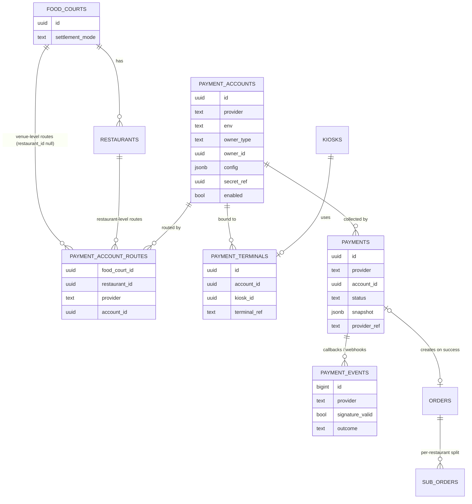
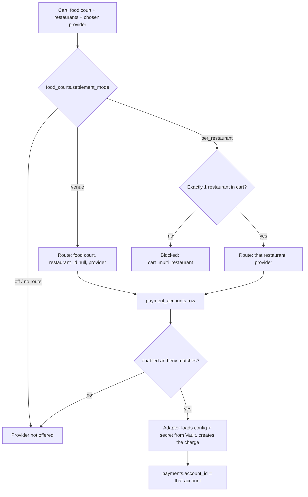
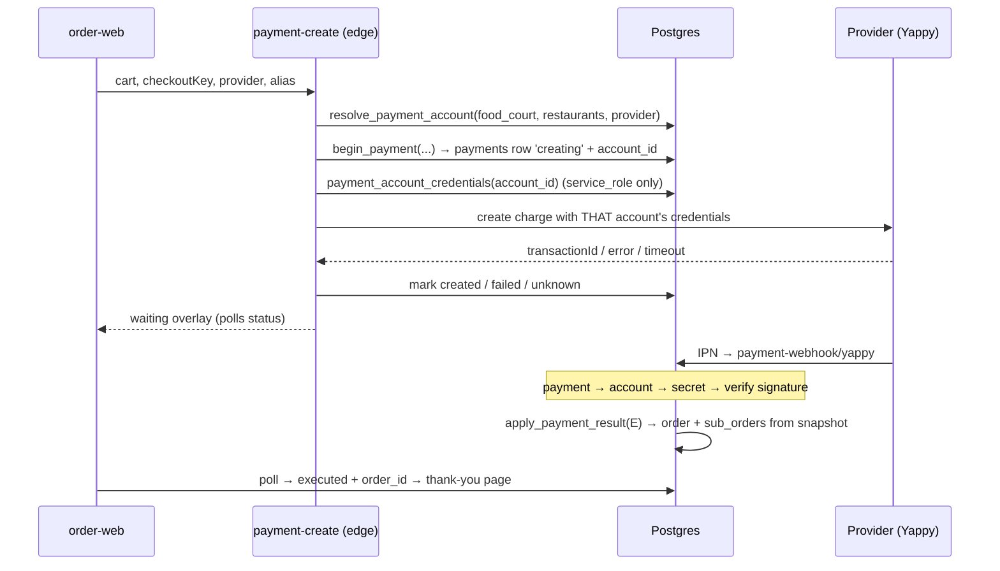

# Plan: Payments architecture — multi-provider, venue vs per-restaurant settlement

Status: **draft, iterating** · Started 2026-10-25 · Owner: Edgar
Related: `plans/yappy-test-plan.md` (Yappy UAT), migrations `049_yappy_payments.sql`, `050_yappy_shorter_grace.sql`

## 1. Context and goals

The Yappy pay-first flow (migration 049) works end to end in UAT, but it is hard-wired to **one merchant per
environment**, read from Edge Function secrets (`YAPPY_UAT_MERCHANT_ID` / `YAPPY_UAT_SECRET`). Before production
we generalize, while the only data is test data.

The platform must support, chosen per food court:

- **Venue collection** — one order can hold several restaurants, one payment goes to a **Kiki** account, Kiki
  pays each restaurant out later.
- **Direct collection** — one restaurant per order, the payment goes straight to **that restaurant's** account.
- **Many providers and banks** — Yappy, Banco General / Banistmo terminals (ECR), future online gateways.
  Different food courts and restaurants use different ones.

## 2. Settlement modes

`food_courts.settlement_mode` decides **who collects**, independent of **which provider**.

| | `venue` | `per_restaurant` |
|---|---|---|
| Who collects | A Kiki account | The restaurant's own account |
| Restaurants per order | 1..n | exactly 1 |
| Account resolved from | food court routes | that restaurant's routes |
| Payments per order | 1 | 1 |
| Payout to restaurants | Kiki, from the `sub_orders` split | none — already theirs |
| Refunds | from Kiki's account, then settle with restaurant | from the restaurant's account |
| order-web cart | mixed carts allowed | second restaurant blocked ("Tu pedido es de X, ¿vaciar carrito?") |

One Kiki account can be routed to many `venue` food courts — credentials entered once.
Plaza Mayor today = `venue` + the current Yappy UAT merchant → same behavior as now.

## 3. Diagrams

### 3.1 Entities



### 3.2 Which account gets paid



### 3.3 Online pay-first (Yappy today, any online provider later)



## 4. Data model

### `payment_accounts` — one account with one provider
| column | notes |
|---|---|
| `id` uuid PK | |
| `provider` text | `yappy`, `bg_ecr`, `banistmo_ecr`, … — a code known to the adapter registry |
| `env` text | `uat` / `prod` |
| `display_name` text | "Kiki Yappy", "Sushi Bar — Banistmo" |
| `owner_type` text | `kiki` / `restaurant` / `food_court` — whose money; drives settlement reports |
| `owner_id` uuid null | restaurant / food court id; null for Kiki |
| `config` jsonb | non-secret, validated per provider in code (Yappy: `merchantId`, `domain`) |
| `secret_ref` uuid | `vault.secrets.id` — secret key never stored in plain text |
| `enabled` bool, `disabled_reason`, `disabled_at` | circuit breaker per account |

### `payment_account_routes` — which account serves what
| column | notes |
|---|---|
| `food_court_id` uuid | |
| `restaurant_id` uuid null | null = venue-level route |
| `provider` text | one route per provider → a restaurant can have Yappy from one bank and card from another |
| `account_id` uuid FK | |

Unique: `(food_court_id, provider) WHERE restaurant_id IS NULL` and `(restaurant_id, provider) WHERE restaurant_id IS NOT NULL`.
Check: route's provider = account's provider; restaurant belongs to the food court.

### `food_courts.settlement_mode`
`off` | `venue` | `per_restaurant` (default `off`).

### `payments` — replaces `yappy_payments`
Same lifecycle as today (`creating → created | failed | unknown → executed | cancelled | expired`), same
guarantees (order created only from the snapshot, `executed` terminal, late success accepted, one active attempt per
cart / payer). Changes:

| column | notes |
|---|---|
| `provider`, `account_id` (FK, NOT NULL) | the account that collected; frozen at begin, survives mode changes |
| `restaurant_id` null | set in `per_restaurant` mode, for reports |
| `provider_ref` | Yappy `orderId`; other providers' reference |
| `provider_txn_id` | Yappy `transactionId`, terminal auth code, … |
| `provider_data` jsonb | provider-specific fields (Yappy `alias`, `document_name`, token) |
| everything else | as in 049: amounts, `snapshot`, `checkout_key`, `order_id`, `refund_required`, `fulfillment_error`, `resolved_at`, `resolution_note`, … |

Active-attempt uniqueness moves to `(provider, payer_ref)` where `payer_ref` = Yappy alias (null for terminals).

### `payment_events` — replaces `yappy_ipn_events`
`provider`, `provider_ref`, `raw` (query/body), `signature_valid`, `outcome`, `received_at`.

### `payment_terminals` — kiosk bank terminals
`account_id`, `kiosk_id`, `terminal_ref` (device / merchant terminal id). Kiosk records a `payments` row after the
terminal approves, so terminal sales land in the same ledger.

### Secrets
Supabase Vault. `payment_account_credentials(account_id)` = SECURITY DEFINER, returns `config` + decrypted secret,
`GRANT EXECUTE` to `service_role` only. Base URLs per provider/env stay in Edge Function secrets (they are the
provider's, not the merchant's).

### Functions
- `resolve_payment_options(food_court_id, restaurant_ids[])` → providers offered for this cart, each with its
  `account_id` (diagram 3.2). Replaces `get_payment_options`. Anon-callable but returns no account internals.
- `begin_payment(...)` → as `yappy_begin_payment`, plus `provider`, `account_id`; circuit breaker per account.
- `apply_payment_result(payment_id, outcome, provider_ref, confirmation)` → generic `yappy_apply_ipn`. Order
  creation from snapshot unchanged (`sub_orders[]` already handles 1..n restaurants).

## 5. Code structure

```
supabase/functions/
  _shared/payments/
    core.ts          resolve → begin → adapter.createCharge → mark; status mapping
    registry.ts      provider code → adapter
    yappy.ts         adapter: createCharge (validate/merchant + payment-wc), verifyCallback (hash), mapStatus
    <provider>.ts    later
  payment-create/    generic entry (yappy-create becomes a thin alias during migration)
  payment-webhook/   /payment-webhook/<provider> → adapter.verifyCallback → apply_payment_result
```

Adapter interface:

```ts
interface PaymentAdapter {
  provider: string
  channel: 'online' | 'terminal'
  validateConfig(config: unknown): void
  createCharge(input: ChargeInput, creds: Credentials): Promise<ChargeResult>   // created | failed | unknown
  verifyCallback(req: Request, creds: Credentials): Promise<CallbackResult>     // signature + outcome
}
```

Webhook flow: parse `provider_ref` → load `payments` → its `account_id` → credentials → verify signature. A callback
is never verified with "the" secret, always with the paying account's.

order-web: `getPaymentOptions` → `resolve_payment_options`; cart enforces one restaurant when the venue is
`per_restaurant`; checkout UI per provider stays (Yappy button, etc.).

Admin (`apps/admin-web`): inside the restaurant's settings and the food court's settings — accounts (provider,
merchant id, secret write-only, enable), routes, settlement mode. Kiki accounts under the SaaS ops panel.

## 6. Migration from 049/050

| today | target |
|---|---|
| `yappy_merchants` (PK `food_court_id`, `env`, `enabled`, `domain`) | `payment_accounts` (Kiki, `yappy`, `uat`, config `{merchantId, domain}`) + venue route for Plaza Mayor + `settlement_mode = 'venue'` |
| `YAPPY_UAT_MERCHANT_ID` / `YAPPY_UAT_SECRET` secrets | merchant id → `config`, secret → Vault (`secret_ref`) |
| `yappy_payments` | `payments` (`provider='yappy'`, `account_id` backfilled, alias → `payer_ref`/`provider_data`) |
| `yappy_ipn_events` | `payment_events` |
| `yappy_begin_payment` / `yappy_apply_ipn` / `get_yappy_payment_status` | `begin_payment` / `apply_payment_result` / `get_payment_status` |
| `yappy_attention` view | `payment_attention` with provider + account owner |
| `yappy-create` / `yappy-ipn` | `payment-create` / `payment-webhook/yappy` (keep old URLs as aliases until Yappy's registered `ipnUrl` changes) |

Only test rows exist → rename + backfill in one migration; no dual-write period needed.

## 7. Phases

1. **Finish Yappy UAT on current code** — T1 (E) and T2 (C) once UAT app access arrives. Proves the flow.
2. **Schema + core + Yappy adapter** — sections 4–6, Plaza Mayor in `venue` mode. Behavior identical; rerun UAT T1–T5.
3. **`per_restaurant` mode** — order-web cart rule, routes per restaurant, admin screens.
4. **Kiosk terminals into the ledger** — `payment_terminals`, kiosk writes `payments`.
5. **Later** — settlement / payout reports for `venue` mode, commissions, next provider adapter.

Not now: adapters for providers we don't have, payouts, commissions.

## 8. Open questions

- [ ] **Yappy: can several merchants register the same domain** (`order.estoeskiki.com`)? Blocks `per_restaurant`
      with Yappy. Ask `botondepagoyappy@bgeneral.com`. If no: subdomain per restaurant, or `venue` only for Yappy.
- [ ] **Kiosk terminals in `per_restaurant` mode:** a shared kiosk's terminal belongs to one bank merchant. Do BG /
      Banistmo terminals support multi-merchant, or does each restaurant need its own terminal/kiosk?
- [ ] One-restaurant cart rule: only in `per_restaurant` venues, or everywhere? (Current lean: driven by mode.)
- [ ] Fallback: in a `per_restaurant` venue, may a restaurant without its own account fall back to the venue/Kiki
      account? (Current lean: no, until a real case.)
- [ ] Merchant of record / legal: Kiki collecting on behalf of restaurants (`venue`) — invoicing and tax implications.
- [ ] Refund API: Yappy void/refund APIs are undocumented; needed for automated refunds in either mode.

## 9. Decisions log

| date | decision |
|---|---|
| 2026-10-25 | Merchant is its own entity (`payment_accounts`), not a column on food court or restaurant. |
| 2026-10-25 | Settlement mode is per food court and provider-independent. |
| 2026-10-25 | Every payment stores `account_id`; callbacks are verified with that account's secret. |
| 2026-10-25 | Secrets in Supabase Vault, readable by `service_role` only. |
| 2026-10-23 | Waiting overlay grace after Yappy's 5 min reduced 10 → 1 min; server frees alias at 5:30 (migration 050). |
